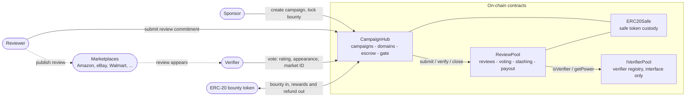
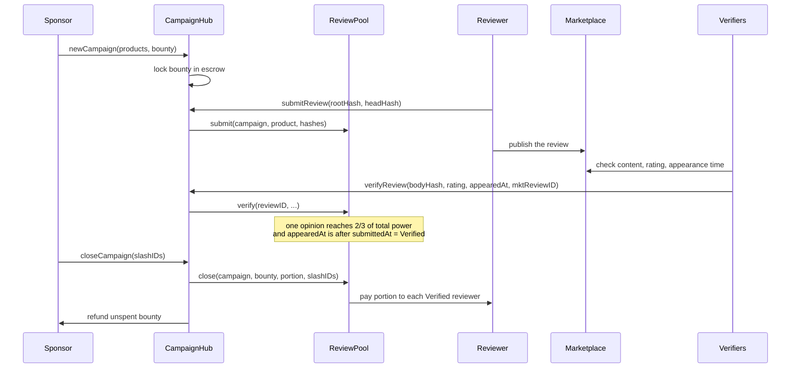

# Review Protocol — Decentralized Review Verification & Rewards

Smart contracts that pay bounties only for **provably genuine** e-commerce reviews.

> Sponsors fund a bounty. Reviewers commit their review on-chain *before* it appears
> on the marketplace. Verifiers cross-check that the same content really appeared.
> Only verified reviews get paid — fake, copied or never-published reviews earn
> nothing and can be slashed at settlement.

Solidity ^0.8.9 · Hardhat · OpenZeppelin · April 2023 · Unaudited, exploratory — not for production use.
Full design notes: **[docs/DESIGN.md](docs/DESIGN.md)**

## Architecture



## Flow



## Contracts

| Contract | Lines | Role |
| --- | ---: | --- |
| `contracts/CampaignHub.sol` | 330 | Campaign lifecycle, marketplace domains, bounty escrow; the single gate into the pool |
| `contracts/ReviewPool.sol` | 211 | Review state machine, hash-chain commitments, power-weighted voting, slashing, payouts |
| `contracts/ERC20Safe.sol` | 58 | Safe ERC-20 custody helpers for escrow and payouts |
| `interfaces/` | — | `IReviewPool`, `IVerifierPool` — the cross-contract surface |

Mechanics, the voting math, the trust model and known limitations live in
**[docs/DESIGN.md](docs/DESIGN.md)**.

## Build

```shell
npm install
npx hardhat compile
npx hardhat run scripts/deploy.js
```
