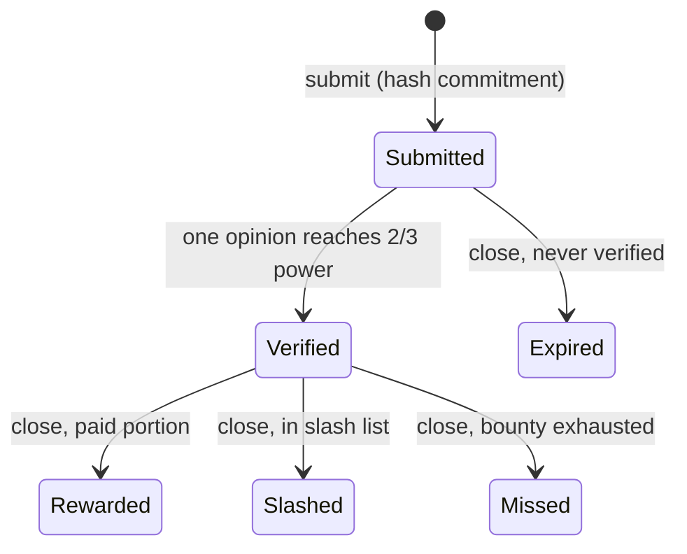

# Review Protocol — Design Notes

Details behind the [README](../README.md): mechanics, voting math, trust model
and limitations.

## The problem

Marketplace reviews are valuable and therefore farmed: copied reviews, paid
review rings, and reviews for products the "reviewer" never touched. A sponsor
who wants to reward genuine reviewers needs a way to pay only when a review
provably (a) was written by the claimant, (b) actually appeared on the
marketplace, and (c) was not copied from an existing review.

## Mechanics, step by step

### 1. Campaigns

A sponsor calls `CampaignHub.newCampaign` either for a whole marketplace
domain (e.g. all of Amazon) or for an explicit product list (max 1,000
products; max 10 campaigns per product). The campaign fixes:

- `bounty` — total ERC-20 reward pool, locked into the contract at creation
  via `ERC20Safe.lockERC20` (sponsors can top up while the campaign runs);
- `portion` — the fixed amount each verified review earns;
- `distrib` — distribution mode (only `DISTRIB_EQUAL` is implemented);
- `startAt / stopAt / cutoffAt / closing` — submission window, then a
  moderation window, then a closing window.

Marketplaces are configured per domain: rating scale (not everywhere is
5 stars) and moderation delay (how long that marketplace takes to publish a
submitted review). If a review is submitted near the cutoff on a slow
marketplace, the campaign's cutoff extends automatically by that domain's
moderation delay.

### 2. Submission — the hash-chain commitment

Review content never goes on-chain. A review is committed as hashes:

```
rootHash = keccak256(headHash, bodyHash)
```

- `headHash` commits to the review's headline/metadata;
- `bodyHash` commits to the body text, revealed only at verification time;
- `prodHash` identifies the product (`keccak256(domain, productID)`).

`CampaignHub.submitReview` fans one submission out to every open campaign
covering that product, and deduplicates per (product, rootHash, campaign), so
the same review cannot be paid twice by the same campaign.

### 3. Verification — power-weighted supermajority

Verifiers inspect the review on the marketplace and vote through
`CampaignHub.verifyReview`, which validates the rating against the domain's
scale and forwards to `ReviewPool.verify`. A vote is an *opinion*:

```
opinion = keccak256(rating, appearedAt, mktReviewID)
```

Each verifier's opinion accumulates *power* from the verifier pool
(`IVerifierPool.getPower`). A review becomes `Verified` when one single,
consistent opinion holds **at least 2/3 of total power** — verifiers must
agree on the facts, not just vote "yes".

Before marking verified, the pool also checks the winning opinion's
`appearedAt` is **after** the on-chain `submittedAt`. This ordering is the
anti-copy mechanism: you must commit your content on-chain before it appears
on the marketplace, so an already-published review cannot be claimed
retroactively.

### 4. Settlement

After the cutoff, the sponsor calls `closeCampaign` with a slash list:
slashed reviews lose their reward, every remaining `Verified` review is paid
its portion, leftovers are refunded to the sponsor. If the sponsor never
closes, anyone can call `expireCampaign` after the closing window and settle
with an empty slash list — bounty funds cannot get stuck in the contract.

### Review state machine



## Design decisions

- **Commitments instead of on-chain text.** Cheap, keeps review content
  private until reveal, and the commitment is timestamped — which is what
  makes the publish-ordering check possible at all.
- **Agreement on facts, weighted by power.** One-person-one-vote invites
  Sybil verifiers; fact-agreement with a 2/3 power threshold means a review
  is verified only when independent verifiers observed the *same* rating,
  time and marketplace ID.
- **Single-gate mediation.** `ReviewPool` accepts state changes only from
  `CampaignHub` (its `gate`). Validation that needs campaign/domain context —
  rating scales, moderation windows, cross-campaign deduplication — lives in
  the hub; the pool stays a focused state machine.
- **Escrow with guaranteed exit.** Bounties are locked up front (sponsors
  cannot promise and vanish), and the permissionless `expireCampaign` path
  guarantees reviewers and sponsors can always settle.

## Trust model

- The **verifier pool is trusted input**: membership and power come from
  `IVerifierPool`, whose implementation is deliberately not part of this
  repository (`contracts/VerifierPool.sol` is a stub). The protocol is only
  as honest as its verifier set.
- The **gate** pattern means `CampaignHub` is the single entry point; its
  admin role (`AccessControl`) manages the marketplace domain list.
- Sponsers can slash only at close time and only reviews in their own
  campaign; they cannot redirect rewards, only withhold them via the slash
  list — which is itself visible on-chain.

## Limitations

- Exploratory code from April 2023: **unaudited, never deployed to mainnet,
  not for production use**.
- Only the `DISTRIB_EQUAL` distribution mode is implemented.
- `VerifierPool` is an interface plus stub — no staking/slashing of
  verifiers is implemented here.
- No dedicated test suite yet; `test/` still contains the default Hardhat
  sample test.
- Known wart: `ReviewPool` reuses the per-campaign review counter as the
  review ID space, and vote tallying loops over all verifiers per vote
  (O(n^2) in the worst case) — acceptable at demo scale, not at production
  scale.
